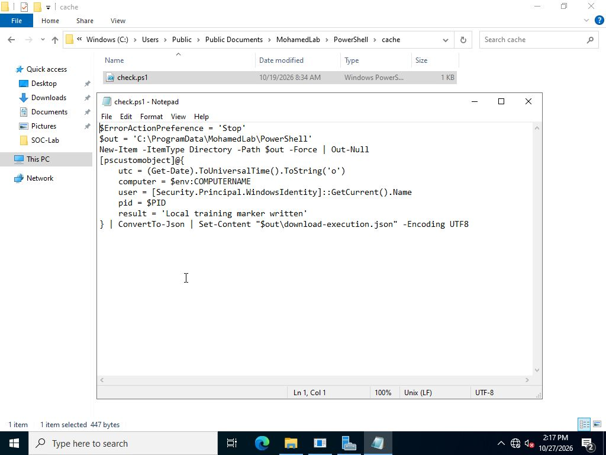
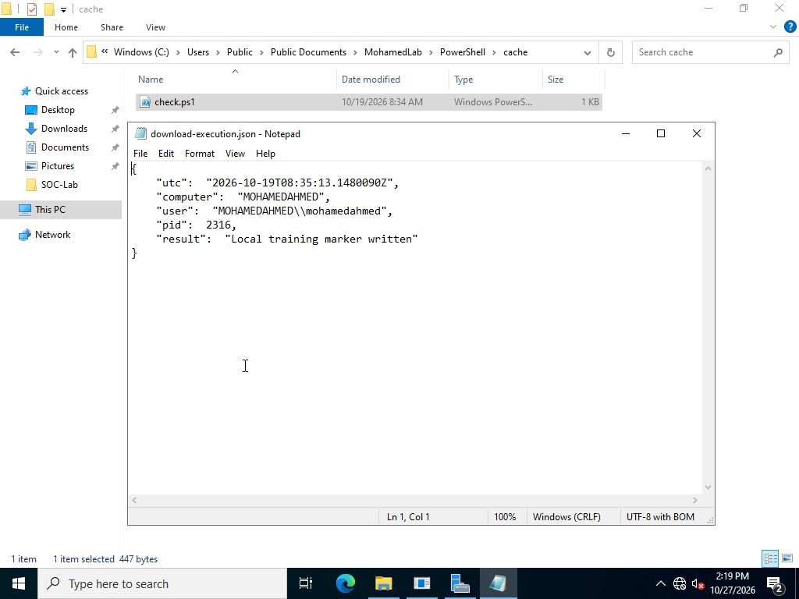

# PowerShell Execution Investigation

Tracing three PowerShell cases in Splunk: local inventory, encoded inventory, and an encoded launcher that downloads and runs a harmless lab script.

The aim is to tell routine administration from activity that needs investigation. Encoding and a hidden window are useful leads; the script content, process chain, connection and output explain what happened.

## Cases

| Case | Launcher PID | Result |
| --- | ---: | --- |
| Inventory | 3328 | Writes local inventory JSON |
| Encoded inventory | 2296 | Writes inventory JSON through `-EncodedCommand` |
| Download and execution | 2644 | Downloads `check.ps1` and starts child PowerShell PID 2316 |

All three launchers returned exit code 0. The download case used the internal service `10.0.2.2:8766`; the sample only writes a local training marker.

## Investigation

Start with the process timeline, then check the encoded launches, recorded script blocks, connection and created files. Each saved search answers one question and keeps the source record ID available for checking the original XML.

The selected evidence contains **19 Windows events**: four Sysmon process events, four Security 4688 events, four PowerShell 4104 events, six Sysmon file events and one Sysmon network event.

The inventory control also uses encoding. The download case adds a cached script, an HTTP connection and a child process. That combination gives a stronger reason to investigate than `-EncodedCommand` alone.

## File inspection

The cached script is 447 bytes. Its SHA256 matches the supplied sample: `634266e42d9ac4732db2130198f227f08fa79888cedf7b48bce4b7f5f239bb0d`.

Reading the file in Notepad shows that it records the time, computer, account and executing PID in `download-execution.json`.

The saved output identifies PID 2316 and the original local account, matching the child process in the source events.

## Project files

- [Investigation notes](docs/investigation.md)
- [Search guide](docs/search-guide.md)
- [Build and reproduce](docs/reproduce.md)
- [Evidence index](evidence/README.md)
- [Splunk dashboard](splunk/app/default/data/ui/views/investigation.xml)

This is an isolated lab using safe payloads. On a real endpoint, an unexpected download-and-execute chain would need further scoping and a response decision under the incident playbook.
