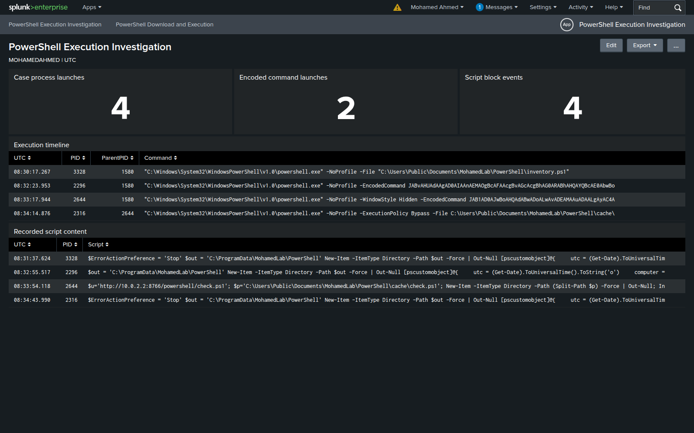

# Investigation notes

## Environment

| Component | Configuration |
| --- | --- |
| Windows endpoint | `MOHAMEDAHMED`, Windows Server 2022 Evaluation |
| Local account | `MOHAMEDAHMED\mohamedahmed` |
| PowerShell | Windows PowerShell 5.1 |
| Endpoint telemetry | Sysmon process, network and file events; Security 4688; PowerShell 4104 |
| SIEM | Splunk Enterprise 9.4.1 on `MOHAMED-SIEM` |
| Service address | `10.0.2.2:8766`, reachable only inside the lab |

The Windows machine is standalone. The Linux VM hosts Splunk. All timestamps in the investigation are UTC.

## Collected evidence

The selected window is `2026-10-19T08:30:13.3510736Z` to `2026-10-19T08:35:26.8511287Z`. It contains **19 native Windows records**. The full selection is listed in [selection.json](../evidence/selection.json).

| Provider | Event ID | Records |
| --- | --- | ---: |
| Microsoft-Windows-Security-Auditing | 4688 | 4 |
| Microsoft-Windows-Sysmon | 1 | 4 |
| Microsoft-Windows-PowerShell | 4104 | 4 |
| Microsoft-Windows-Sysmon | 11 | 6 |
| Microsoft-Windows-Sysmon | 3 | 1 |

The normalized JSONL and original event XML identify the same channel/record-ID pairs. Event 4104 can be split into several parts; use its ScriptBlockId and part fields before interpreting long content. PID pivots are constrained to this host and time window, then checked against ProcessGuid.

## Process and content pivots

1. Start with [the process timeline](../evidence/search-results/01-process-timeline.csv), recording UTC time, PID and parent PID. Use the original events for ProcessGuid and full command lines.
2. Isolate the two encoded launches using [the encoded-command search](../splunk/searches/02-encoded-commands.spl). Decode the argument as Base64-encoded UTF-16LE text without running it. The decoded values are in [run.json](../evidence/run.json).
3. Compare the decoded text with [the recorded script blocks](../evidence/search-results/03-script-blocks.csv). A command-line flag does not describe everything a downloaded script can do.
4. For the download case, follow the launcher to `check.ps1`, its child PowerShell process, the internal HTTP connection and `download-execution.json`.
5. Compare the downloaded file's hash with [lab/check.ps1](../lab/check.ps1). `NotSigned` describes signature status; it does not by itself establish maliciousness.

## Findings

The two inventory cases write local inventory JSON. Encoding changes the launch representation, while the recorded script content still explains the behavior. The third case adds a download, a cached script and a second PowerShell process. Its local output records the executing PID and account.

The recorded launchers have wsmprovhost.exe as their parent. The download launcher then creates a separate PowerShell child to run the file. PID and ProcessGuid pivots connect the launcher, downloaded file, child process and output.

FileCreate events may include directory creation as well as files. The dashboard excerpts are for reading; use the original XML and JSONL for full command lines and process identifiers.

## Triage decision

The download case confirms execution of the safe payload: launcher PID 2644 retrieved `check.ps1`, child PowerShell PID 2316 ran it, and `download-execution.json` recorded that child PID and account. The downloaded script creates an output directory and writes a local execution marker. These observations establish the simulated download-and-execute behavior.

The inventory comparisons completed without that download/child-execution chain. One also used encoding, so the encoded-command match is a starting point for reading the command rather than the final verdict.

An unexpected occurrence of the download chain on a real endpoint would justify escalation with the decoded command, original records, file hash, destination and affected account. Scoping and containment are response recommendations, separate from the executed lab cases.

## File checks

[Windows file properties](../images/windows-file-properties.jpg) show the cached script. Read the [sample source](../lab/check.ps1) alongside the recorded 4104 events. The PowerShell output view displays the original inventory and download-case results.

The hash and signature check uses `Get-FileHash` and `Get-AuthenticodeSignature`:

## Dashboard

The overview groups the same evidence into case counts, process launches and script content. Its display expressions shorten long text; the saved searches and source files retain the full values.

