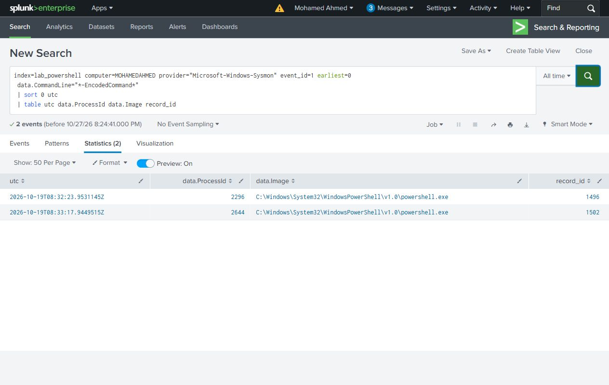
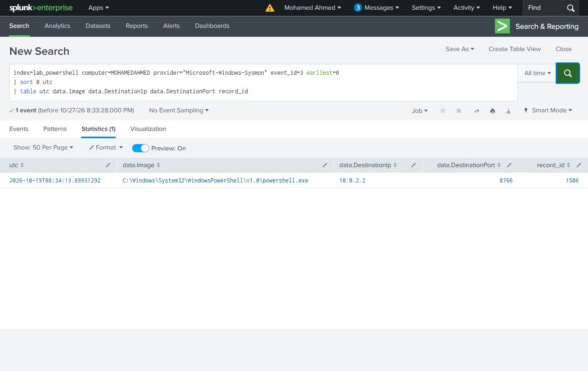
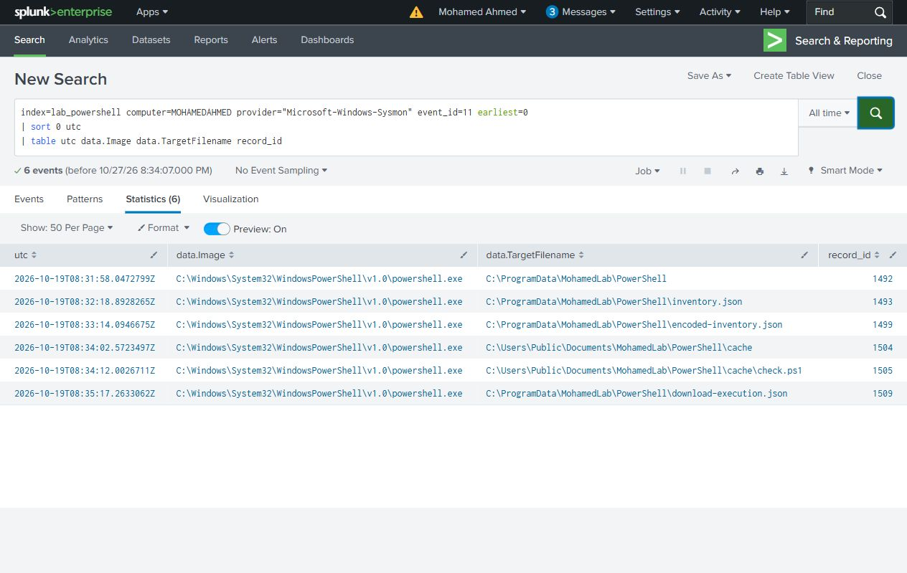
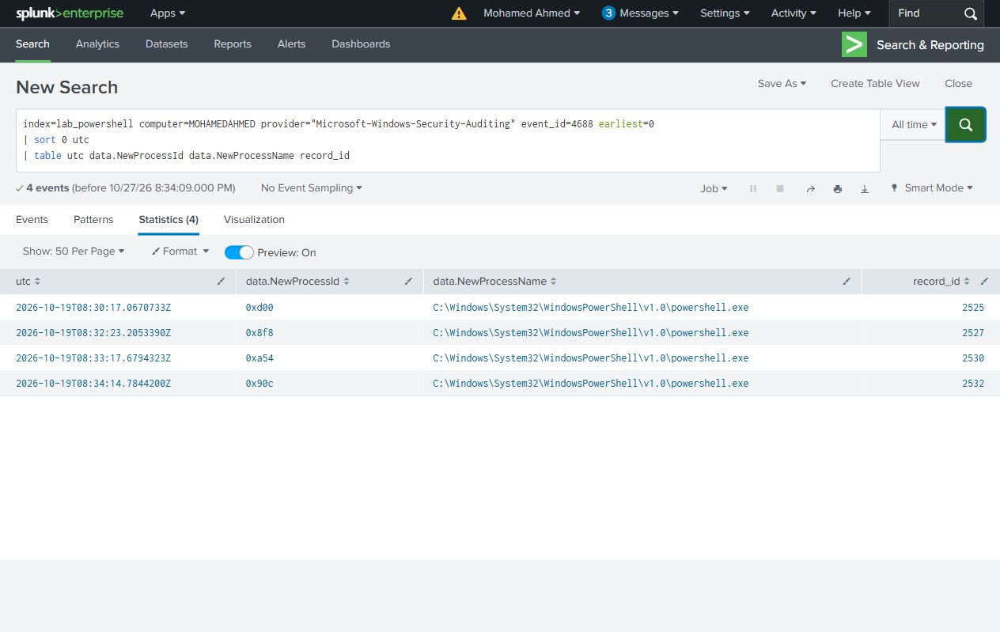
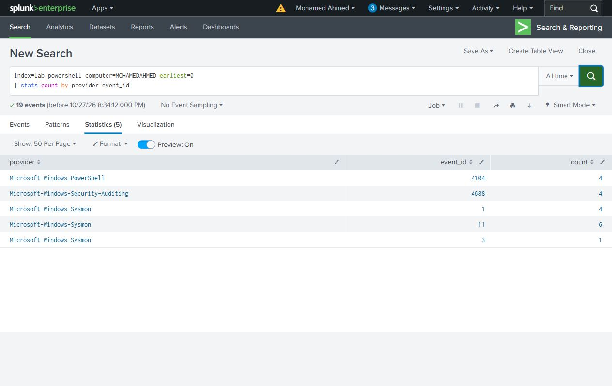

# Search guide

Run the searches in Splunk Search & Reporting with the time picker set to **All time**. `earliest=0` includes the recorded lab data. The tables use source `utc` for event time and `record_id` to find the original Windows record. `data.*` fields come from the Windows event payload.

The index contains the selected evidence for this investigation. On a live index, also restrict the host and time window before following a PID.

## Which processes started?

The parent PID connects the download launcher to child PID 2316. Check ProcessGuid and full command lines in the original events when following a process.

```spl
index=lab_powershell computer=MOHAMEDAHMED provider="Microsoft-Windows-Sysmon" event_id=1 earliest=0
| sort 0 utc
| table utc data.ProcessId data.ParentProcessId data.Image record_id
```

Result: **4 rows**. [CSV](../evidence/search-results/01-process-timeline.csv) · [Search file](../splunk/searches/01-process-timeline.spl)


## Which launches used encoding?

Both encoded inventory and the download launcher match. Decode UTF-16LE Base64 as text, then compare it with the recorded script blocks.

```spl
index=lab_powershell computer=MOHAMEDAHMED provider="Microsoft-Windows-Sysmon" event_id=1 earliest=0
 data.CommandLine="*-EncodedCommand*"
| sort 0 utc
| table utc data.ProcessId data.Image record_id
```

Result: **2 rows**. [CSV](../evidence/search-results/02-encoded-commands.csv) · [Search file](../splunk/searches/02-encoded-commands.spl)



## What script content was recorded?

Event 4104 exposes the inventory code, download launcher and local marker script. This is more useful than judging the encoded argument by appearance.

```spl
index=lab_powershell computer=MOHAMEDAHMED provider="Microsoft-Windows-PowerShell" event_id=4104 earliest=0
| sort 0 utc
| table utc data.ScriptBlockText record_id
```

Result: **4 rows**. [CSV](../evidence/search-results/03-script-blocks.csv) · [Search file](../splunk/searches/03-script-blocks.spl)


## Where did PowerShell connect?

The one selected network event points to the lab HTTP service on port 8766.

```spl
index=lab_powershell computer=MOHAMEDAHMED provider="Microsoft-Windows-Sysmon" event_id=3 earliest=0
| sort 0 utc
| table utc data.Image data.DestinationIp data.DestinationPort record_id
```

Result: **1 rows**. [CSV](../evidence/search-results/04-network-connections.csv) · [Search file](../splunk/searches/04-network-connections.spl)



## What files were created?

Follow the cached script and JSON outputs. Sysmon FileCreate records can include directory creation.

```spl
index=lab_powershell computer=MOHAMEDAHMED provider="Microsoft-Windows-Sysmon" event_id=11 earliest=0
| sort 0 utc
| table utc data.Image data.TargetFilename record_id
```

Result: **6 rows**. [CSV](../evidence/search-results/05-created-files.csv) · [Search file](../splunk/searches/05-created-files.spl)



## Does Security auditing confirm process creation?

Security 4688 provides another view of the same four PowerShell processes.

```spl
index=lab_powershell computer=MOHAMEDAHMED provider="Microsoft-Windows-Security-Auditing" event_id=4688 earliest=0
| sort 0 utc
| table utc data.NewProcessId data.NewProcessName record_id
```

Result: **4 rows**. [CSV](../evidence/search-results/06-security-process-creation.csv) · [Search file](../splunk/searches/06-security-process-creation.spl)



## Is all selected telemetry present?

The five provider/event combinations total 19 source events. This is coverage, not an additional set of events.

```spl
index=lab_powershell computer=MOHAMEDAHMED earliest=0
| stats count by provider event_id
```

Result: **5 rows**. [CSV](../evidence/search-results/07-coverage.csv) · [Search file](../splunk/searches/07-coverage.spl)


